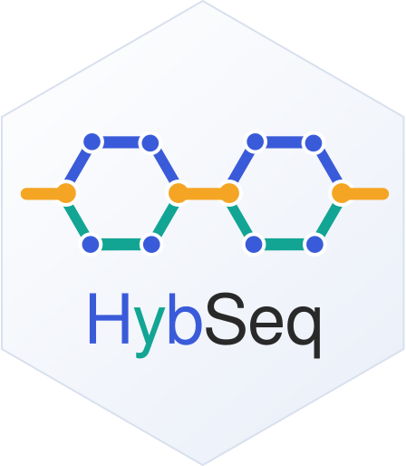

# HybSeq  

A [Nextflow](https://github.com/nextflow-io/nextflow) pipeline for **pangenome-graph based processing of DNA-seq and RNA-seq data from interspecific hybrids** built with [Minigraph-Cactus](https://github.com/ComparativeGenomicsToolkit/cactus), [vg](https://github.com/vgteam/vg), [bcftools][https://github.com/samtools/bcftools] and [htslib](https://github.com/samtools/htslib).

The pipeline first constructs a pangenome graph from the genome assemblies of the two parental species. It then maps short reads to the graph, using a spliced graph derived from the reference graph for RNA-seq data. Read support is subsequently quantified, variants are called for each sample, and results are tabulated by assay. DNA-seq and RNA-seq are implemented as separate workflows but share the same reference graph and downstream steps for read-support calculation, variant calling, and result tabulation.

## Installation

### Prerequisites

Before installing HybSeq, ensure that the following software is available:

- **Nextflow (≥ 26.04):** HybSeq use [Nextflow](https://nextflow.io/) as its workflow management system. Nextflow can be installed from the command line, via Bioconda, or by downloading it from [GitHub](https://github.com/nextflow-io/nextflow).
- **Apptainer:** Install [Apptainer](https://apptainer.org/docs/admin/main/installation.html#installation-on-linux) to run HybSeq using the `apptainer` profile.

### Obtain HybSeq

Download HybSeq from the [GitHub releases page](https://github.com/gxelab/hybseq/tags), or clone the repository using Git:

```bash
git clone https://github.com/gxelab/hybseq.git
cd hybseq
```

### Run HybSeq with test data

HybSeq includes a script to simulate reads for testing the installation. From the repository root, run the following command to generate the test data:

```bash
python3 test/simulate_reads.py
```

Next, edit `test/assemblies.txt` to specify the absolute paths to the two reference genome assemblies. For example:

```text
ref_a    /absolute/path/to/hybseq/test/data/ref_a.fa
ref_b    /absolute/path/to/hybseq/test/data/ref_b.fa
```

Run HybSeq using the `test` and `apptainer` profiles:

```bash
nextflow run . -profile test,apptainer
```

The `test` profile specifies the input files and output directory, so these parameters do not need to be provided explicitly. The command above is equivalent to the following command, which specifies all parameters directly:

```bash
nextflow run . -profile apptainer \
    --samplesheet test/samplesheet.csv --assemblies test/assemblies.txt --gtf test/data/ref_a.gtf \
    --ref_name ref_a --outname test --outdir test/results
```

### Check the results

The test workflow takes approximately 10 minutes to complete. Upon successful completion, the output files will be written to `test/results/`. If the workflow fails, inspect `.nextflow.log` in the repository root for diagnostic information.

### Run with local container images

By default, HybSeq automatically downloads the required software container images when the workflow runs. If automatic downloading fails, you can manually download the Apptainer image files (`.sif`) and provide their paths to the workflow.

From the repository root, run:

```bash
mkdir -p sifs
apptainer pull sifs/vg.1.73.sif docker://quay.io/vgteam/vg:v1.73.0
apptainer pull sifs/cactus.3.1.4.sif docker://quay.io/comparative-genomics-toolkit/cactus:v3.1.4
apptainer pull sifs/bcftools.1.24.sif docker://quay.io/biocontainers/bcftools:1.24--h118bc1c_4
```

Once the images have been downloaded, rerun the test workflow and specify the local image paths:

```bash
nextflow run . -profile test,apptainer \
    --vg_sif sifs/vg.1.73.sif \
    --cactus_sif sifs/cactus.3.1.4.sif \
    --bcftools_sif sifs/bcftools.1.24.sif
```


## Inputs

- **Assemblies seqfile** (`--assemblies`): Minigraph-Cactus seqfile, one `<name><TAB><fasta path>` per line; the reference must match `--ref_name`. See [`assets/assemblies.txt`](assets/assemblies.txt).
- **Samplesheet** (`--samplesheet`): see below. See [`assets/samplesheet.csv`](assets/samplesheet.csv) for an example.
- **GTF** (`--gtf`, required for `--run rnaseq|both`): transcript annotation of the reference assembly.

## Samplesheet format

CSV with header and four columns:

```csv
sample,assay,fastq_1,fastq_2
dna_a,dnaseq,/path/to/dna_a_R1.fq.gz,/path/to/dna_a_R2.fq.gz
dna_b,dnaseq,/path/to/dna_b.fq.gz
dna_hybrid,dnaseq,/path/to/dna_hybrid_R1.fq.gz,/path/to/dna_hybrid_R2.fq.gz
rna_a,rnaseq,/path/to/rna_a.fastq.gz
rna_b,rnaseq,/path/to/rna_b_R1.fq.gz,/path/to/rna_b_R2.fq.gz
```

- `sample`: sample id (used as `vg call -s` and as the output file prefix)
- `assay`: `dnaseq` or `rnaseq`
- `fastq_1` / `fastq_2`: read paths. **Library layout is inferred** for both assays: `fastq_2` empty → single-end, non-empty → paired-end. For single-end rows simply omit the trailing column (missing columns are padded with empty strings).

Validation: unknown assays and rows without `fastq_1` are rejected with explicit errors.

There is no replicate column and no per-sample reference column: every sample maps to the *same* graph. Pooled samples are simply one sample — pooling happens upstream of the pipeline.

## Configuration

All settings live in [`nextflow.config`](nextflow.config):

| param | default | meaning |
|---|---|---|
| `ref_name` | `ref` | cactus `--reference`; GTF rename prefix (applied to every contig name, whatever the naming scheme); must match the seqfile reference name |
| `outname` | `pangenome` | cactus `--outName`; prefixes all graph artifacts |
| `giraffe_threads` / `pack_threads` | 16 | `vg giraffe` / `vg pack` `-t` |
| `call_threads` | 4 | `vg call` `-t` |
| `mpmap_threads` | 8 | `vg mpmap` `-t` |
| `rna_threads` | 8 | `vg rna --threads` |
| `gcsa_threads` | 4 | `vg index -t` (GCSA build) |
| `cactus_cons/index/mg_cores`, `cactus_map_cores` | 16 / 16 / 16 / 4 | `--consCores/--indexCores/--mgCores/--mapCores` |
| `min_mapq` | 5 | `vg pack -Q` (ignore reads below this MAPQ) |
| `gcsa_tmpdir` | `tmp` | `vg index -b` temporary directory |
| `rna_call_sample` | `null` | `vg call -s` for RNA; null → sample id, or a fixed name (a fixed name is only valid for a single RNA sample: it makes the sample column identical in every RNA VCF, which `bcftools merge` rejects) |
| `run` | `both` | `both` \| `dnaseq` \| `rnaseq` |
| `outdir` / `publish_dir_mode` | `results` / `copy` | outputs; `symlink` recommended for large GAMs |

Container images (versions the pipeline is developed and tested against):

- `vg_container` = `quay.io/vgteam/vg:v1.73.0` (vg 1.73)
- `cactus_container` = `quay.io/comparative-genomics-toolkit/cactus:v3.1.4` (cactus 3.1.4)
- `bcftools_container` = `quay.io/biocontainers/bcftools:1.24--h118bc1c_4` (bcftools 1.24)

**Profiles**

- `apptainer` — run with Apptainer. Local SIF paths are optional and override the registry images:

  ```bash
  -profile apptainer \
    --vg_sif /path/to/vg.sif \
    --cactus_sif /path/to/cactus.sif \
    --bcftools_sif /path/to/bcftools.sif
  ```

  The home directory is bound by default in `nextflow.config` with:
  
  ```groovy
  apptainer.runOptions = '--bind $HOME:$HOME'
  ```
  
  To mount extra host paths, pass a config file in the following format:
  
  ```groovy
  // apptainer.config 
  apptainer.runOptions = '--bind $HOME:$HOME --bind /my/data:/my/data'
  ```
  with `-c`:
  ```bash
  nextflow run . -profile apptainer -c apptainer.config 
  ```
  
  **Note:** `-c` overrides any matching setting in `nextflow.config` — not just bind mounts, but also `params`, `process` resources, etc.

- `test` — small inputs simulated from real *Drosophila* chromosome 4 assemblies for the smoke test; generate them first with `python3 test/simulate_reads.py` (`test/run_smoke.sh` does that automatically). See [development.md](development.md#smoke-test)
- `docker` — run with Docker images. (experimental)
- `podman` — run with Podman. (experimental)

**Platform.** Cactus needs an x86-64 CPU with AVX2, so the reference workflow runs only on x86-64 Linux hosts (or a VM that provides AVX2); macOS hosts are limited to `-stub-run` smoke tests. Earlier releases shipped `applecontainer` and `conda` profiles — both were removed: Apple-silicon emulation provides no AVX2, and bioconda's cactus is not usable for this pipeline.

Resource note: cactus RAM/time are config defaults (64 GB / 48 h) and should be adjusted to your assemblies. All cactus Toil scratch stays under `--outdir` (`toil_work/`, with the jobstore at `toil_work/js`) and the cactus task removes it again — on failure as well as on success. Scratch left behind by a run that was killed outright is deleted at the start of the next attempt, so rerunning into the same `--outdir` needs no manual cleanup. Nothing in `toil_work/` is published.

## Usage

### Run the full pipeline

The following command runs the complete HybSeq pipeline using Apptainer and locally stored SIF images. The reference graph is constructed once and then used for both DNA-seq and RNA-seq analyses.

```bash
nextflow run . -profile apptainer \
    --assemblies assemblies.txt --samplesheet samplesheet.csv --gtf annotation.gtf

# use local images
nextflow run . -profile apptainer \
    --vg_sif /path/to/vg.sif --cactus_sif /path/to/cactus.sif --bcftools_sif /path/to/bcftools.sif \
    --assemblies assemblies.txt --samplesheet samplesheet.csv --gtf annotation.gtf
```

Replace the SIF paths and input file paths with those appropriate for your environment.

### Run a single assay

To run only one assay, specify the corresponding value using the `--run` parameter. For DNA-seq analysis:

```bash
nextflow run . -profile apptainer --run dnaseq ...
```

For RNA-seq analysis, provide the gene annotation file using `--gtf`:

```bash
nextflow run . -profile apptainer --run rnaseq --gtf annotation.gtf ...
```

Replace `...` with the remaining required parameters for your analysis.

### Alternative container profiles

**The Docker and Podman profiles are still under testing.** Their usage is shown below for users who wish to test these options.

Docker:

```bash
nextflow run . -profile docker --assemblies assemblies.txt --samplesheet samplesheet.csv --gtf annotation.gtf
```

Podman:

```bash
nextflow run . -profile podman --assemblies assemblies.txt --samplesheet samplesheet.csv --gtf annotation.gtf
```

## Outputs

Published under `--outdir` (`results/` by default):

| dir | contents |
|---|---|
| `ref/` | reference graph + index artifacts: `<outname>.gbz/.dist/.dist.bak/.shortread.withzip.min/.shortread.zipcodes/.snarls/.log/.gfa/.vcf`, the renamed `<ref_name>.gtf`, and the spliced-graph artifacts `<outname>_spliced.pg/.xg/.gcsa/.gcsa.lcp/.snarls/.dist` |
| `dna/` | per DNA sample: `<sample>.gam`, `<sample>.gam.log`, `<sample>.pack`, `<sample>.vcf.gz`; with ≥2 DNA samples also `<sample>.vcf.gz.csi` per sample and combined: `combined.vcf.gz`, `combined.vcf.tsv.gz`; with a single DNA sample: `combined.vcf.tsv.gz` only |
| `rna/` | per RNA sample: `<sample>.gam`, `<sample>.pack`, `<sample>.vcf.gz`; with ≥2 RNA samples also `<sample>.vcf.gz.csi` per sample and combined: `combined.vcf.gz`, `combined.vcf.tsv.gz`; with a single RNA sample: `combined.vcf.tsv.gz` only |

`<outname>_spliced.pruned.pg` and `<outname>.dist2` are intermediates and are never published; `<outname>.dist.bak` is the archived cactus distance index and `<outname>.dist` is the rebuilt index used for mapping. The TSVs carry one row per VCF record (CHROM, POS, ID, REF, ALT, QUAL, FILTER, per-sample GT, DP, AD{0}, AD{1}, GQ) and are suited as inputs to downstream tabular analyses.

`<sample>.vcf.gz.csi` and `combined.vcf.gz` are produced only when an assay has more than one sample: an index only enables merging, and a single sample has nothing to merge, so the sample VCF is queried directly and only the assay-level table (`combined.vcf.tsv.gz`) is published. The table's columns are the same either way.

## Workflows

The pangenome graph is built once and reused by both assays; after mapping, DNA-seq and RNA-seq run the same read-support, variant-calling, and tabulation steps. `--run` selects which workflows execute (`both` by default).

### Pangenome graph construction

**Built once per run, for both assays** (reference workflow):

1. Build the pangenome graph with **Minigraph-Cactus 3.1.4** (`cactus-pangenome`, GBZ/GFA/VCF outputs, giraffe mapping indexes)
2. Rebuild the distance index after cactus: archive the cactus-produced `<outname>.dist` as `<outname>.dist.bak`, build the index with `vg index -j`, and promote the rebuilt index to `<outname>.dist`

**Needed for RNA-seq only** (skipped entirely with `--run dnaseq`; requires `--gtf`):

3. Prefix every GTF contig with `<ref>#0#` so the names match GBZ haplotype-path names — any contig naming scheme (`bin/rename_gtf_for_vg.sh`)
4. Build the spliced pangenome graph with **vg rna** (PackedGraph, `--use-hap-ref --gbz-format`)
5. Index the spliced graph: `vg index -x` (xg) → `vg prune` → `vg index -g` (GCSA) → `vg snarls` → `vg index -j` (dist)

A DNA-seq analysis uses steps 1–2 only; an RNA-seq analysis uses all five. Step 2 runs whichever assay is selected (it belongs to the shared reference workflow), but only DNA-seq consumes it: `vg giraffe -d` takes the rebuilt `<outname>.dist`, whereas `vg mpmap -d` takes the spliced `<outname>_spliced.dist` from step 5.

### Read mapping

One mapper run per sample, single-end or paired-end (layout inferred from the samplesheet, one `-f` per read file — see [Samplesheet format](#samplesheet-format)). Only the graph mapped against and the mapper differ between the assays:

| | DNA-seq | RNA-seq |
|---|---|---|
| Graph mapped against | GBZ (`<outname>.gbz`) | spliced PackedGraph built by `vg rna` (`<outname>_spliced.pg`) |
| Mapper | `vg giraffe -Z <outname>.gbz -m <outname>.shortread.withzip.min -z <outname>.shortread.zipcodes -d <outname>.dist` | `vg mpmap -x <outname>_spliced.xg -g <outname>_spliced.gcsa -d <outname>_spliced.dist -n RNA -l short` |
| Indexes needed | steps 1–2 (giraffe min/zipcodes + rebuilt distance index) | step 5 (spliced xg/gcsa/dist) |
| Reads per sample | single-end or paired-end | single-end or paired-end |

### Variants calling

Shared by both assays, per sample:

1. Compute read support with **vg pack** (`-Q 5`, i.e. `min_mapq`)
2. Call variants with **vg call** (`-a`, plus `-z` for DNA-seq only)
3. Index, merge and tabulate the assay's samples with **bcftools** (`index -f` → `merge` → `query`; skipped for a single sample, which is queried directly into `combined.vcf.tsv.gz`)

Graph-dependent differences:

| | DNA-seq | RNA-seq |
|---|---|---|
| Graph for `vg pack` / `vg call` | `<outname>.gbz` | `<outname>_spliced.xg` |
| Snarls | cactus `<outname>.snarls` | `<outname>_spliced.snarls` (step 5) |
| `vg call` sample and flags | `-z -a`, `-s` = sample id (`-z` uses the GBZ haplotypes) | `-a` only (`-z` is only valid for a GBZ); `-s` = sample id or `--rna_call_sample` |

Each assay aggregates to its own `combined.vcf.gz` / `combined.vcf.tsv.gz` under `dna/` or `rna/`; see [Outputs](#outputs) for the published files.


## AI assistance

This pipeline and its documentation were developed with AI assistance. AI-generated content was reviewed and revised by the authors, who are responsible for the final content.

| | |
|---|---|
| Models | DeepSeek V4 Flash / Pro |
| Harness | deepseek-harness + Claude Code |


## Citation

Citation for hybseq and for every dependency it runs (Minigraph-Cactus, vg, giraffe, mpmap, bcftools, Nextflow, …) are collected in [`citations.md`](citations.md).

## License

This project is released under the MIT License. See [`LICENSE`](LICENSE) for the full text.

Copyright (c) 2026 RNA GxE lab @ LZU.
